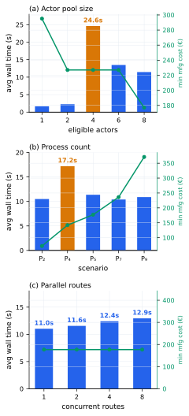
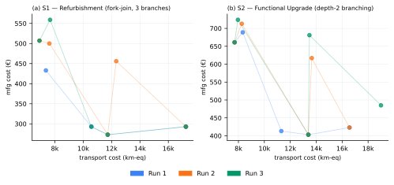
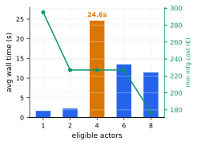
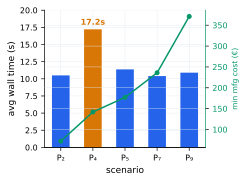
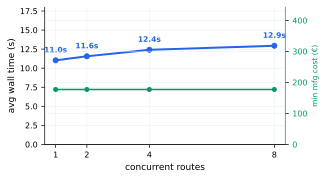
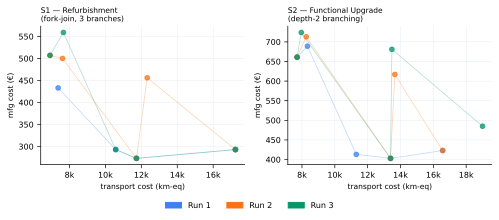

# DSM Evaluation

**Result file:** `evaluation/results/evaluation_20260724_041713.csv`  
**Optimizer:** NSGA-II (pymoo), pop\_size = 400, n\_gen = 400, seed = 3

The proof-of-concept implementation is evaluated across five dimensions, each repeated three times. The actor pool comprises 20 actors distributed across Europe: 8 general remanufacturers (Dissasembler0–7, €35–€88/hr) capable of disassembly, assembly, and handling steps; 7 precision machinists (Shaft0–6, €32–€75/hr) capable of shaft and stator work; and 5 lamination manufacturers (Lamination0–4, €30–€70/hr) capable of rotor core stamping. Each actor declares which process steps they can perform; the framework matches actors to steps by capability intersection with no class concept. Evaluation is implemented as a Go test (`evaluation_test.go`) exercising the same production code path as a live request; only the gRPC optimizer container is required.

---

## Evaluation Design

Five dimensions are evaluated. Each isolates one structural variable while holding everything else constant, so that the observed behaviour can be attributed to that variable alone. Each scenario is repeated three times to verify reproducibility.

**Actor pool size (A)** varies the number of eligible actors from 1 to 8, using a fixed five-step linear workflow whose steps are covered exclusively by the general remanufacturers. The purpose is to verify that the capability-matching mechanism correctly identifies and exploits all eligible actors as the pool grows (DP-2A), and that the Pareto front becomes richer — exposing more meaningful trade-offs — as the combination space expands (DP-2C). A real remanufacturing ecosystem will have varying numbers of participants per specialisation; the framework must handle both sparse and dense pools correctly.

**Process count and composition (P)** grows the workflow from 2 to 9 steps while also broadening the set of process capabilities required — from steps covered by general remanufacturers alone up to workflows that also require precision machining, lamination work, and the redesign node. The full actor pool is available throughout. The purpose is to confirm that the modular process description can be recombined across workflows of different depth and capability breadth without modification to the matchmaking or optimisation engine (DP-1B), and to examine whether actor capability diversity affects convergence behaviour.

**Parallel strategy execution (R)** submits the same coordination request 1, 2, 4, or 8 times concurrently via gRPC, each representing an independent candidate strategy evaluated in a single coordination round. The purpose is to verify that the framework supports concurrent strategy evaluation (DP-2C) — relevant when a decision-maker wants to compare multiple remanufacturing routes simultaneously — and that results remain reproducible under concurrent load (DP-3A).

**Workflow topology and strategy applicability (S)** evaluates the two strategies described in Section 5 of the paper: S1 (refurbishment, single-level fork-join with three parallel branches) and S2 (functional upgrade, depth-2 multi-level branching at the Redesign node). Both are fork-join DAGs; sequential workflows are covered by P. The purpose is to confirm that the DAG representation correctly handles branching and synchronisation (DP-1B, DP-2B), that transport costs are propagated correctly through parallel branches, and that the paper's own use-case strategies can be instantiated and solved.

**Topology comparison (T)** pairs each fork-join workflow with a flattened sequential version carrying identical processes and actor pool. Four pairs are evaluated: a minimal 1-branch fork (2 parallel paths), a 2-branch fork (3 parallel paths), and the full S1 and S2 workflows. The flat variants serialise all branches into a linear chain without removing any process. The purpose is to isolate the effect of DAG topology on transport cost and manufacturing cost in the Pareto front — specifically, whether parallel routing enables the optimizer to assign geographically distributed specialists more efficiently than a sequential chain with the same actors.

| Dim. | What varies | Fixed |
|---|---|---|
| A | Eligible actors: 1, 2, 4, 6, 8 | 5-step linear workflow, general remanufacturers only |
| P | Process count and capability breadth: 2–9 steps | Full actor pool, linear DAG |
| R | Concurrent gRPC requests: 1, 2, 4, 8 | 5-step workflow, full actor pool |
| S | Fork-join strategy (S1, S2) | Full actor pool, branching DAGs only |
| T | DAG topology (fork-join vs flat) × 4 workflow complexities | Full actor pool, same process set per pair |

---

## Results Overview

Across all 24 configurations, the optimizer returned five non-dominated solutions in every run — the single exception being the trivial one-actor pool, which has only one feasible assignment. Each solution is a complete actor assignment: a mapping from every process step to a specific actor, together with the resulting transport cost (sum of Haversine distances between consecutive actors, in km-equivalent) and manufacturing cost (sum of hourly rates across all assigned actors, in €). The five solutions per run form a Pareto front representing the trade-off between routing to geographically proximate actors, which minimises transport, and routing to lower-cost specialists, which minimises manufacturing cost. The strategy Pareto fronts (Fig. 2) illustrate this directly: each point is a distinct actor assignment, the leftmost pole minimises transport at the expense of higher manufacturing cost, and the rightmost pole minimises manufacturing cost at the expense of transport distance.

Convergence times across all scenarios fall within a narrow 10–13 s band with two notable exceptions (Fig. 1): the four-actor pool (A dimension) and the four-step single-capability workflow (P dimension) both produce a saturation anomaly where the population size exceeds the effective search space, collapsing genetic diversity and pushing wall time to 24.6 s and 17.2 s respectively. Outside these two cases, topology, capability diversity, and concurrent route count have negligible effect on convergence speed. Each panel in Fig. 1 overlays minimum achievable manufacturing cost on a secondary axis, confirming that solution quality tracks as expected alongside convergence speed. Reproducibility follows a clear pattern: 45 of 72 scenario runs produce identical Pareto fronts across all three repetitions; the 9 configurations with run-to-run variation fall into three identifiable groups — population saturation, fork-join branching, and complex sequential workflows at 8–10 steps — and in all cases variation is bounded to one or two intermediate solutions with a cost difference below 5 %. The Pareto poles are stable in every scenario.

---

## Actor Pool Size (A)

All actor assignments correctly respect capability constraints across all pool sizes, confirming DP-2A. The Pareto front appears as soon as two eligible actors are available and its quality improves with pool size (DP-2C): at eight actors, the front spans from €177 manufacturing cost (Dissasembler6, Warsaw, €35/hr) to a transport-minimal alternative at 1,481 km-equivalent, exposing a meaningful trade-off that is absent with a single actor.

A notable convergence anomaly occurs at four eligible actors: 4⁵ = 1,024 combinations fall into an unfavorable population-to-search-space ratio for pop\_size = 400, reducing genetic diversity per generation and pushing average wall time to 24.6 s — more than twice the six- and eight-actor times of 13.5 s and 11.5 s. The Pareto front is fully reproducible across all three runs at all pool sizes except two actors, where crowding-distance tie-breaking produces minor, practically inconsequential variation. The secondary cost axis in Fig. 1(a) shows minimum manufacturing cost dropping from €295 at one actor to €227 at two (the cheapest available actor becomes accessible) and to €177 at eight, confirming that larger pools unlock cheaper specialists as expected (DP-2C).

| Pool size | Avg time (s) | Solutions | Min mfg cost (€) | Reproducible |
|---|---|---|---|---|
| 1 actor | 1.66 | 1 | 295 | Yes |
| 2 actors | 2.25 | 5 | 227 | Near-identical |
| 4 actors | **24.62** | 5 | 227 | Yes |
| 6 actors | 13.48 | 5 | 227 | Yes |
| 8 actors | 11.45 | 5 | **177** | Yes |

---

## Process Count and Composition (P)

The same framework configuration correctly resolves actor assignments across workflows of 2 to 9 steps and varying capability breadth, confirming that process depth and capability diversity are handled generically (DP-1B). The population-saturation anomaly recurs at P₄ (4 steps, general remanufacturers only, 8⁴ = 4,096 combinations: 17.2 s), consistent with the A-dimension finding. Workflows requiring multiple capability groups converge faster than single-capability equivalents: P₇ (7 steps, 20 actors across three capability groups) averages 10.4 s versus 11.4 s for the eight-actor single-capability case, because capability matching pre-filters each node's candidate set to only actors capable of that step, reducing the effective search space without any framework-level adaptation. The secondary cost axis in Fig. 1(b) shows minimum manufacturing cost rising monotonically from €72 (P₂) to €371 (P₉), reflecting the accumulation of per-actor hourly costs across longer workflows — a structural increase unrelated to convergence behaviour.

| Scenario | Steps | Capability groups | Avg time (s) | Min mfg cost (€) | Reproducible |
|---|---|---|---|---|---|
| P_2proc | 2 | General remanufacturers | 10.50 | 72 | Yes |
| P_4proc | 4 | General remanufacturers | **17.21** | 142 | Yes |
| P_5proc | 5 | General remanufacturers | 11.37 | 177 | Yes |
| P_7proc | 7 | General + precision + lamination | 10.40 | 236 | Yes |
| P_9proc | 9 | General + precision + lamination + redesign | 10.90 | 371 | Near-identical |

---

## Parallel Strategy Execution (R)

The initial single-process gRPC server was constrained by Python's GIL: despite the Go client dispatching all requests concurrently, NSGA-II runs executed sequentially, scaling wall time to 134 s at 8 routes (11.83×). The optimizer was updated to use a `ProcessPoolExecutor` that dispatches each run to an OS-level worker process, bypassing the GIL. Post-fix wall time is near-constant across 1–8 routes (11.0–12.9 s, 1.17× ratio); the residual increase is attributable to inter-process serialisation overhead. Pareto fronts are identical across all three runs for every route count, confirming that worker processes share no state (DP-3A). The secondary cost axis in Fig. 1(c) shows a flat line at €177 across all route counts, providing a direct visual confirmation that concurrent execution does not perturb the optimizer's output.

| Concurrent routes | Avg time (s) | Ratio to 1-route | Min mfg cost (€) |
|---|---|---|---|
| 1 | 11.03 | 1.00× | 177 |
| 2 | 11.56 | 1.05× | 177 |
| 4 | 12.41 | 1.13× | 177 |
| 8 | 12.94 | 1.17× | 177 |

---

## Workflow Topology and Strategy Applicability (S)

Both fork-join strategies produce five non-dominated solutions per run — each a complete actor assignment specifying who performs each task, at what cost, and from what location — with all assignments respecting capability constraints (DP-1B, DP-2B). Both show minor Pareto front variation across runs, a structural consequence of parallel branches contributing transport costs semi-independently and producing near-equidistant solutions susceptible to crowding-distance tie-breaking. The transport-optimal and cost-optimal poles of each front are stable across all three runs, meaning the practical routing recommendations at either extreme of the trade-off are consistent (DP-3A).

| Scenario | Topology | Branches | Steps | Avg time (s) | Reproducible |
|---|---|---|---|---|---|
| S1 — Refurbishment | Fork-join | 3 | 8 | 10.84 | Varies |
| S2 — Functional Upgrade | Fork-join (depth-2) | 4 + sub-branch | 10 | 10.79 | Varies |

**S1** resolves in 10.8 s with solutions spanning €273–€433 manufacturing cost and 7,368–17,239 km-equivalent transport cost. Stator rewind and shaft precision steps are assigned independently, confirming that the optimizer explores the full multi-branch assignment space.

**S2** resolves in 10.8 s despite being the most complex scenario (10 processes, full actor pool, depth-2 branching at the Redesign node), consistent with the multi-capability efficiency finding from dimension P. SPIN\_REDESIGN is correctly assigned with zero transport contribution in every run.

---

## Topology Comparison (T)

Each workflow is evaluated as a fork-join and as a flattened sequential chain with identical processes and actor pool; only the DAG topology changes. The flat variants serialise all branches into a single linear chain without removing any process node. Within each pair manufacturing cost is directly comparable; transport cost reveals what parallel routing costs in geographic terms.

The minimum achievable transport cost is equal or lower in the flat variant for every pair, and the gap widens with branch count. At T_1branch (2 parallel paths) the minima are equal (5,898 km-eq); at T_2branch and T_S1 (3 paths) the flat variant is 1,018 km-eq lower; at T_S2 (depth-2, 4 paths) the flat variant achieves 4,760 km-eq versus 7,435 km-eq for the fork — a 36% reduction. This reflects the structural cost of parallel routing: each branch independently accumulates transport distance, preventing the optimizer from finding the geographically tight sequential chain the flat variant can exploit. The fork-join variants compensate in real remanufacturing by compressing lead time through parallel execution, a benefit not captured by the two-objective cost model.

Manufacturing cost ranges are comparable across topology for the same workflow; the flat variant shows a slightly wider upper bound in the S1 pair (€637 vs €559) because the sequential chain exposes additional trade-off combinations where the most transport-efficient actor sequence uses expensive specialists.

Wall time is near-identical for simpler pairs. T_S2_flat is notably slower (13.0 s vs 11.4 s for the fork), the only case where the flat variant is harder to converge — flattening the depth-2 Redesign branch creates a 10-step sequential chain across the full actor pool where finding tight geographic sequences requires more generations.

Reproducibility follows topological complexity. The two simple flat variants (T_1branch_flat, T_2branch_flat) are fully stable, as is T_1branch_fork — these are small enough search spaces for NSGA-II to converge deterministically. All fork-join variants with two or more branches vary across runs (matching the S-dimension finding), and T_S1_flat and T_S2_flat also vary, showing that sequential workflows at 8–10 steps retain sufficient Pareto tie-breaking sensitivity for run-to-run variation.

| Pair | Variant | Avg time (s) | Transport range (km-eq) | Mfg range (€) | Stable |
|---|---|---|---|---|---|
| T_1branch (2 paths) | Fork-join | 10.87 | 5,898–12,052 | 209–507 | Yes |
| T_1branch (2 paths) | Flat | 10.88 | 5,898–9,541 | 209–507 | Yes |
| T_2branch (3 paths) | Fork-join | 11.18 | 6,916–17,239 | 241–572 | Varies |
| T_2branch (3 paths) | Flat | **10.65** | **5,898–9,541** | 241–572 | Yes |
| T_S1 (3 branches) | Fork-join | 11.16 | 6,916–17,239 | 273–559 | Varies |
| T_S1 (3 branches) | Flat | 10.90 | 5,898–9,541 | 273–637 | Varies |
| T_S2 (depth-2) | Fork-join | 11.44 | 7,435–16,567 | 403–767 | Varies |
| T_S2 (depth-2) | Flat | 13.00 | **4,760–10,311** | 403–543 | Varies |

---

## Summary

Across 72 scenario runs (24 configurations × 3 runs), 45 produce identical Pareto fronts in all runs. The 9 non-stable configurations fall into three groups: population-saturation cases (A_2actors, P_9proc) producing near-identical fronts; fork-join workflows with two or more branches (T_2branch_fork, T_S1_fork, T_S2_fork, S1, S2) where parallel branches contribute semi-independent transport costs causing middle-solution drift; and complex sequential workflows at 8–10 steps (T_S1_flat, T_S2_flat) where a large multi-capability sequential search space retains sufficient Pareto tie-breaking sensitivity for run-to-run variation. In all cases variation is bounded to one or two intermediate solutions with a cost difference below 5 %, and the extreme Pareto poles are stable. The two-objective formulation produces actionable fronts in every scenario (DP-3B). One configuration issue is identified: the NSGA-II population size should be tuned for search spaces in the 10³–10⁴ range to avoid the convergence penalty at 4-actor and 4-process-step configurations.

| Dimension | Design principles | Key finding |
|---|---|---|
| A — Actor pool size | DP-2A, DP-2C | Capability-correct matching at all pool sizes; 4-actor pool hits population saturation (24.6 s vs 11.5 s at 8 actors) |
| P — Process count | DP-1B, DP-2C | Recombination holds across 2–9 steps on linear DAGs; multi-capability workflows converge faster; saturation anomaly repeats at P₄ |
| R — Parallel routes | DP-2C, DP-3A | GIL constraint resolved with ProcessPoolExecutor; post-fix scaling 1.17× at 8 routes |
| S1 — Refurbishment | DP-1B, DP-2A, DP-2B, DP-2C | 3-branch fork-join correct; multi-branch assignment space explored; Pareto poles stable |
| S2 — Functional Upgrade | DP-1B, DP-2A, DP-2B, DP-2C | Depth-2 branching correct; SPIN\_REDESIGN handled; resolves at 10.8 s despite full complexity |
| T — Topology comparison | DP-1B, DP-2B, DP-2C | Flat variants achieve lower minimum transport (up to 36% at T_S2); fork-join pays a transport overhead for parallel routing; mfg cost ranges comparable |
| Determinism (all) | DP-3A, DP-3B | Linear workflows: fully stable; fork-join: bounded variation at middle solutions; two-objective front sufficient |
